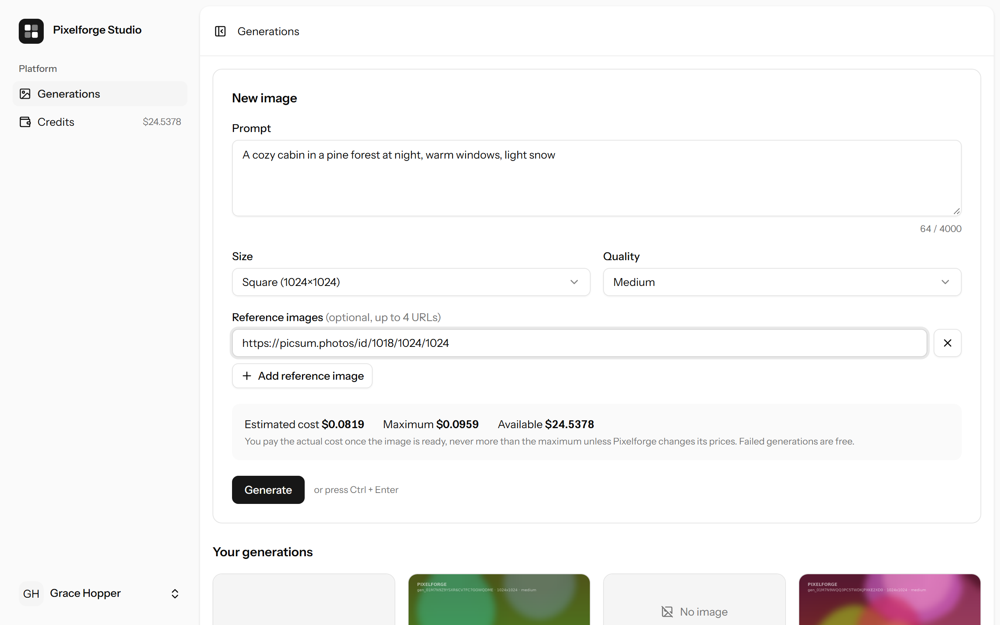
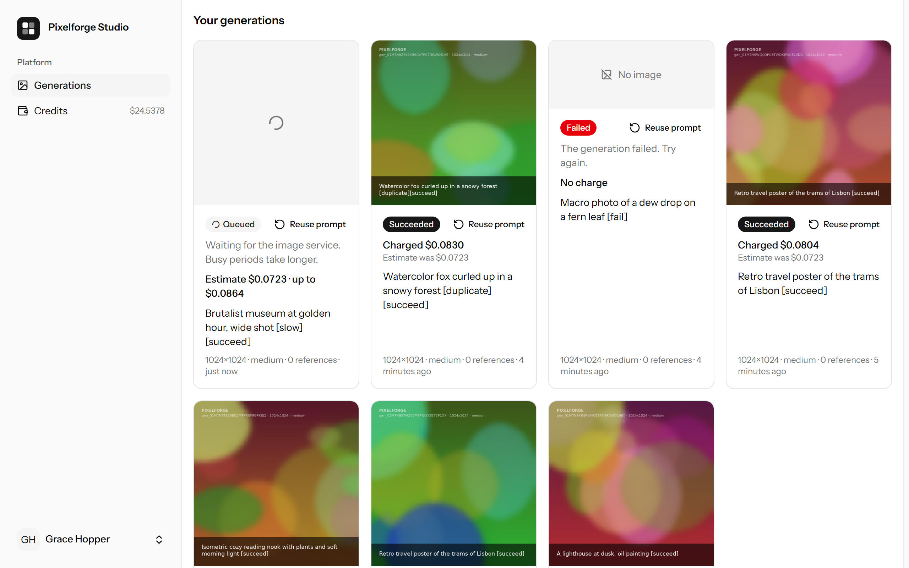
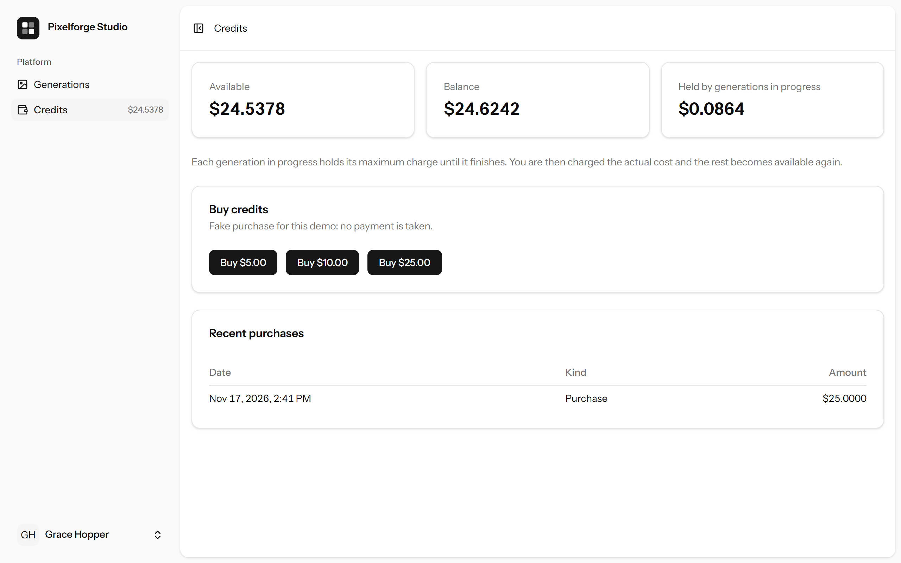
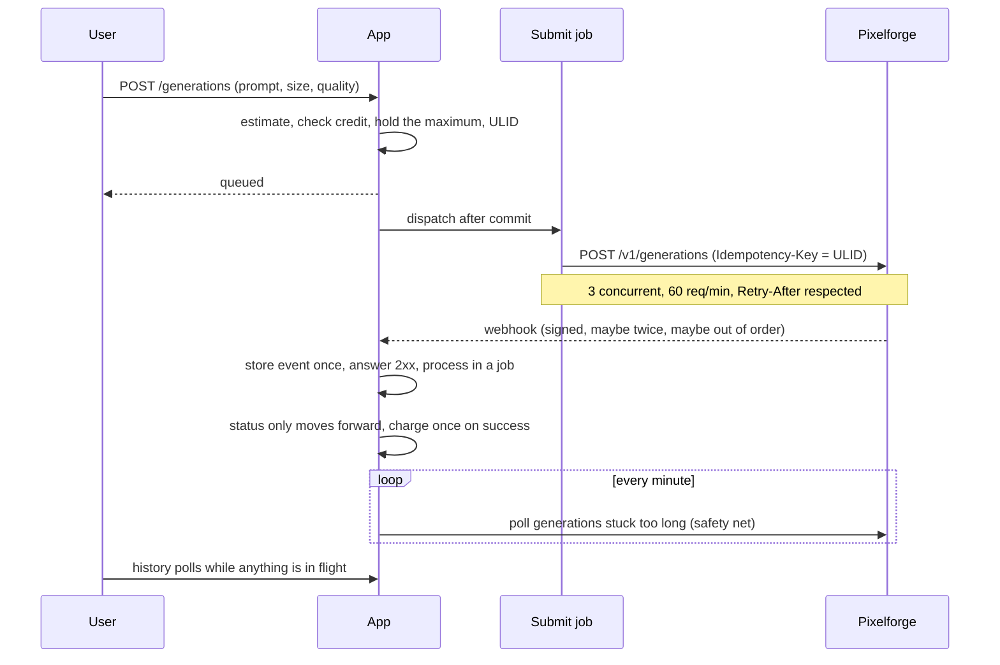
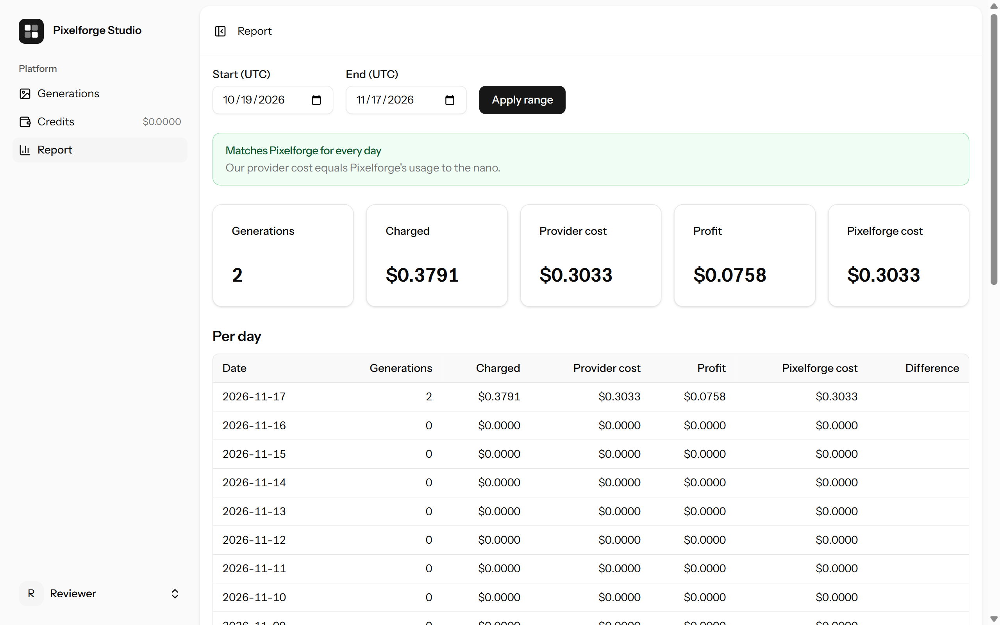
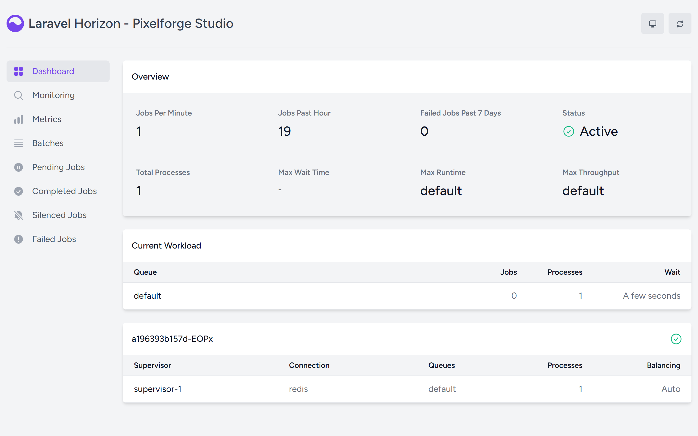
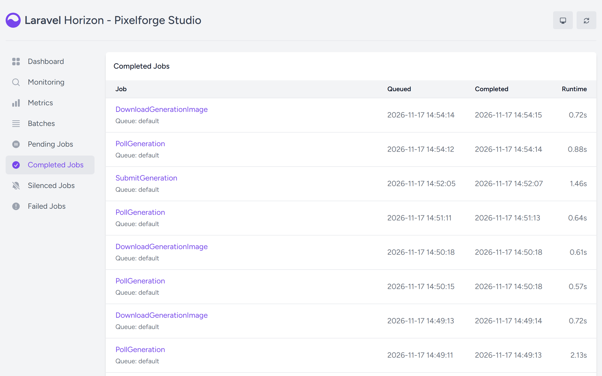
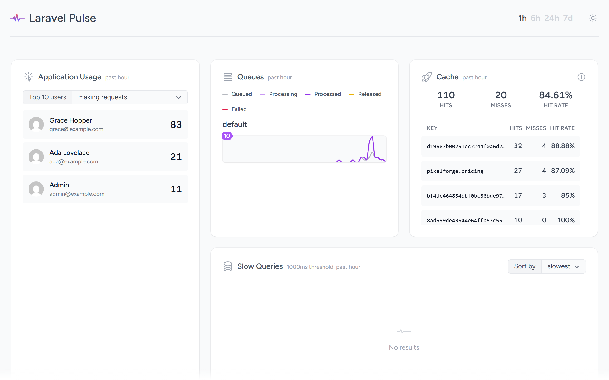

# Pixelforge Studio

[](https://github.com/matheusserpa7/pixelforge-image-generator/actions/workflows/ci.yml)

Signed-in users generate images through [Pixelforge](https://pixelforge.promptedit.dev/docs), a
simulated image-generation API, and pay exactly what each generation cost Pixelforge plus a 25%
markup. They see the price before they submit, failed generations are free, and no generation is
ever charged twice, even when webhooks arrive twice, out of order, or not at all.

A take-home assessment for PromptEdit: Laravel 13, Inertia, Vue 3, MySQL, Redis.

## For reviewers

|                     |                                                                                              |
| ------------------- | -------------------------------------------------------------------------------------------- |
| **Live app**        | https://pixelforge.matheusserpa.online: register, press **Buy credits**, generate            |
| **Operating it**    | [Admin report, Horizon, Pulse, structured logs, Sentry](#operating-it)                       |
| **Where things are**| [Brief → code → test](#the-brief-and-where-it-lives) · [Code map](#code-map)                |
| **Why it is built this way** | [Key decisions](#key-decisions), each with its own [ADR](docs/adr/README.md) |
| **Quality bar**     | 361 Pest tests on MySQL, Larastan at level max, Pint, ESLint, `vue-tsc`, all in CI           |

Everything in the brief is done, both stretch goals included: the admin report and credit balances.

| The price before you generate                                      | History with live status, real charge and why a failure was free |
| ------------------------------------------------------------------ | ---------------------------------------------------------------- |
|  |  |



## The brief and where it lives

| Brief                                                   | Where                                                                                                   | Proof                                                                                                                                            |
| ------------------------------------------------------- | ------------------------------------------------------------------------------------------------------- | ------------------------------------------------------------------------------------------------------------------------------------------------ |
| Prompt, size, quality, reference URLs                   | [`generations/Index.vue`](resources/js/pages/generations/Index.vue), [`StoreGenerationRequest`](app/Http/Requests/StoreGenerationRequest.php) | [`CreateGenerationTest`](tests/Feature/Generations/CreateGenerationTest.php)                                                                     |
| Price **before** submitting                             | [`CostEstimator`](app/Services/Billing/CostEstimator.php): expected charge and the maximum               | [`CostEstimatorTest`](tests/Unit/Services/Billing/CostEstimatorTest.php): "matches the worked example from the API summary"                      |
| Cost + 25%, recorded once a generation finishes         | [`ActualCost`](app/Services/Billing/ActualCost.php), [`Money`](app/Support/Money/Money.php)               | [`ActualCostTest`](tests/Unit/Services/Billing/ActualCostTest.php), [`MoneyTest`](tests/Unit/Support/Money/MoneyTest.php)                       |
| Failures cost nothing                                   | [`ApplyGenerationSnapshot`](app/Actions/ApplyGenerationSnapshot.php)                                      | "maps provider failure codes to local messages and does not charge"                                                                              |
| History with live status, estimated and actual cost, image | [`GenerationController`](app/Http/Controllers/GenerationController.php), Inertia polling              | [`GenerationIndexTest`](tests/Feature/Generations/GenerationIndexTest.php)                                                                       |
| Signed webhooks                                         | [`WebhookSignature`](app/Services/Pixelforge/WebhookSignature.php)                                       | "refuses a missing, bad or stale signature"                                                                                                      |
| Twice or out of order, never recorded twice             | [`ReceivePixelforgeWebhook`](app/Actions/ReceivePixelforgeWebhook.php), [`ProcessWebhookEvent`](app/Jobs/ProcessWebhookEvent.php) | "charges once when the same production payload arrives under another event id", "ignores an older status that arrives after a final one" |
| Deployed                                                | VPS behind a shared edge proxy, `make deploy` ([docs/deployment.md](docs/deployment.md))                 | https://pixelforge.matheusserpa.online                                                                                                           |
| Stretch: admin report, matched to `GET /v1/usage`       | [`BuildAdminReport`](app/Actions/BuildAdminReport.php), `/admin/report`                                  | [`BuildAdminReportTest`](tests/Feature/Reports/BuildAdminReportTest.php): "marks matching days, signed differences and days absent from Pixelforge" |
| Stretch: balances, "Buy credits", block unaffordable    | [`GetCreditBalance`](app/Actions/GetCreditBalance.php), [`credits/Index.vue`](resources/js/pages/credits/Index.vue) | "rejects a generation whose maximum exceeds the available credit", "adds a pack once when the same key is sent twice"                      |

## How money works

All amounts are integers of **nano-USD** (1 USD = 1,000,000,000), stored as `BIGINT` and handled by
one value object backed by `brick/math`. Pixelforge prices to the ninth decimal, so nothing is ever
rounded away. Floats are banned, and an architecture test enforces it ([ADR 0003](docs/adr/0003-money-in-nano-usd.md)).

1. **Estimate.** From cached `GET /v1/pricing`: text tokens are `ceil(chars / 4)`, each reference image
   is 765 tokens, output tokens are exact, and reasoning is a range. The UI shows the expected charge
   and the **maximum** the generation can cost ([ADR 0006](docs/adr/0006-cost-estimation.md)).
2. **Hold.** A generation is accepted only when its maximum fits the user's available credit. That
   maximum is held while the generation runs. Once Pixelforge fixes the real rates, the hold rises if
   they are higher. It never falls ([ADR 0024](docs/adr/0024-derived-credit-balances-with-holds.md)).
3. **Charge.** On success, the cost is computed from the **rates and usage on the generation object**,
   never from cached prices ([ADR 0005](docs/adr/0005-actual-cost-uses-generation-rates.md)). The markup is the one frozen on the generation when it was created, so a
   config change never reprices work in flight. The markup is applied once, half-up to the nano ([ADR 0004](docs/adr/0004-markup-and-rounding.md)).
4. **Ledger.** One append-only row per generation, written in a transaction with a row lock and
   guarded by a unique index. Database triggers refuse any `UPDATE` or `DELETE`. A failure writes
   nothing ([ADR 0010](docs/adr/0010-exactly-once-billing-ledger.md)).
5. **Balance.** Purchases minus charges minus holds, derived from rows, with no counter that could
   drift.

Usage that does not add up to the token types we price is refused, never charged in part.

## How a generation flows



The decisions behind this flow: [idempotent creation](docs/adr/0007-idempotent-creation.md),
[webhook verification and deduplication](docs/adr/0008-webhook-verification-and-dedup.md),
[forward-only status](docs/adr/0009-monotonic-status.md),
[reconciliation by polling](docs/adr/0011-reconciliation-polling.md) and
[provider limits](docs/adr/0012-provider-limits.md).

## What goes wrong, and what happens

The prompt keywords from the Pixelforge docs force each case, so you can try them on the live app:

| Prompt contains | Pixelforge does                                     | The app                                                                                          |
| --------------- | --------------------------------------------------- | ------------------------------------------------------------------------------------------------ |
| `[blocked]`     | `400 content_policy_violation` at submission        | Fails at once with a readable reason. Nothing charged, hold released.                            |
| `[overloaded]`  | `503 overloaded` at submission                      | Retries with backoff and `Retry-After`, then fails after a capped number of attempts. Free.      |
| `[fail]`        | Accepts, then sends `generation.failed`             | Shows "The generation failed. Try again." Nothing charged.                                       |
| `[slow]`        | Takes 60–90 s                                       | History stays live and shows the status until it ends.                                           |
| `[duplicate]`   | Delivers every webhook twice                        | The second delivery is answered as a duplicate. Charged once.                                    |
| `[succeed]`     | Never fails at random                               | Charged exactly cost + 25%. The image is copied to our storage before the provider URL expires.  |

And the cases no keyword forces:

| Situation                                           | The app                                                                                                       |
| --------------------------------------------------- | ------------------------------------------------------------------------------------------------------------- |
| Concurrency limit (`429`) or per-minute limit       | Waits for a slot without using an attempt. A local Redis limiter keeps us under the budget.                    |
| The submit's response is lost (timeout, bad body)   | The generation stays **unconfirmed**, not failed, because the provider may have it. The UI says nothing is charged yet. |
| A webhook arrives before our POST returns           | It is matched through the ULID in `metadata`.                                                                 |
| A webhook is lost, or stored but never processed    | Reconciliation polls stale generations and redispatches unprocessed events.                                   |
| A generation stays in flight for over an hour       | Reported once to operators and listed in the admin report. Never failed locally.                              |
| A user opens someone else's generation              | `403`, through a Policy.                                                                                      |

## Operating it

Production has to be watched, not just deployed. What an operator has, all behind the `admin` Gate:

| Tool                                  | What it answers                                                                                     |
| ------------------------------------- | --------------------------------------------------------------------------------------------------- |
| **Admin report** (`/admin/report`)    | Charged, provider cost and profit per day and per user, each day checked against `GET /v1/usage`, plus generations stuck in flight for over an hour. |
| **Horizon** (`/horizon`)              | Submit, poll, webhook and image jobs: throughput, waits, retries and failures.                      |
| **Pulse** (`/pulse`)                  | Slow requests, queries, jobs and calls to Pixelforge, exceptions, queues, and the busiest users.    |
| **Structured logs**                   | JSON lines on stdout. A `request_id` and `user_id` follow each request into every job it dispatched; generation and webhook logs carry `generation_id` and `event_id`. |
| **Error tracking**                    | Sentry, switched on by `SENTRY_LARAVEL_DSN`. Failed jobs and stuck generations are logged at error level with their context. |
| **Health** (`/health`)                | One public status for uptime checks. The details of what failed go to the logs, not to the public. |

Production admin report. Provider cost and Pixelforge cost are the same on every day.



| Horizon: queue health, no failed jobs                     | Horizon: one generation, job by job                       |
| --------------------------------------------------------- | --------------------------------------------------------- |
|  |  |



Details: [ADR 0019](docs/adr/0019-observability.md) and [docs/deployment.md](docs/deployment.md).

## Code map

A conventional Laravel app. Controllers only validate, call one action and respond, and an
architecture test forbids them from touching the HTTP client.

| What                                   | Where                                                                                       |
| -------------------------------------- | ------------------------------------------------------------------------------------------- |
| Use cases, one `handle` each           | [`app/Actions`](app/Actions)                                                                |
| Money value object                     | [`app/Support/Money/Money.php`](app/Support/Money/Money.php)                                |
| Estimate and actual cost               | [`app/Services/Billing`](app/Services/Billing)                                              |
| Pixelforge client, fake, limiter, signature | [`app/Services/Pixelforge`](app/Services/Pixelforge)                                   |
| Submit, poll, webhook and image jobs   | [`app/Jobs`](app/Jobs)                                                                      |
| Status machine                         | [`app/Enums/GenerationStatus.php`](app/Enums/GenerationStatus.php)                          |
| Webhook endpoint                       | [`PixelforgeWebhookController`](app/Http/Controllers/PixelforgeWebhookController.php)       |
| Reconciliation                         | [`ReconcileGenerations`](app/Actions/ReconcileGenerations.php), every minute                |
| Pages                                  | [`resources/js/pages`](resources/js/pages)                                                  |
| Immutable DTOs                         | [`app/Data`](app/Data)                                                                      |

Provider calls and webhook processing run as jobs on Redis, managed by Horizon. Logs are JSON lines
on stdout, correlated by `request_id`. Production runs the same FrankenPHP image as development.

## Key decisions

The money and flow decisions are linked above. These are the others worth asking about:

| Decision                                                                                                       | Why                                                                           |
| -------------------------------------------------------------------------------------------------------------- | ----------------------------------------------------------------------------- |
| [Fail locally only when the provider cannot have it](docs/adr/0021-local-failure-only-when-provider-cannot-have-it.md) | A lost response never turns into a free image or a double charge.             |
| [Live status through Inertia polling](docs/adr/0015-live-status-via-inertia-polling.md)                         | Live enough for 5–90 s generations, with no WebSocket server to run.           |
| [Report by provider completion day](docs/adr/0023-admin-report-by-provider-completion-day.md)                   | Daily provider cost matches `GET /v1/usage` to the nano.                      |
| [Single VPS behind the edge proxy](docs/adr/0022-single-vps-deployment-behind-edge-proxy.md)                    | One-command deploys next to other sites, TLS by the shared proxy.             |
| [One FrankenPHP image for dev and prod](docs/adr/0016-docker-frankenphp.md)                                      | What runs locally is what runs in production.                                 |

All 24 decisions, each with its context, decision and consequences: [docs/adr](docs/adr/README.md).

## Built with AI, spec-first

Built with Claude Code, under a written process so intent exists before code does. Every change
goes **PRD → tech spec → tasks → implementation → verification**, and the eleven specs are in
[docs/specs](docs/specs) in [roadmap](docs/roadmap.md) order. A human approves each spec before any
code is written.

| Role             | Model                           | What it does                                                                         |
| ---------------- | ------------------------------- | ------------------------------------------------------------------------------------ |
| Spec session     | Opus                            | Writes the PRD, tech spec and tasks, then stops for approval. Afterwards it only orchestrates. |
| `implementador`  | Sonnet                          | Implements one task with its test and returns with `make lint analyse test` green.  |
| `revisor`        | Opus on risk areas, else Sonnet | Reviews the task against the spec, fixes what is small and returns what is big.     |

Risk areas always get the Opus reviewer and can never skip the spec: money and the ledger, webhooks
and status, provider calls, authorization and schema. Spec 010 was an adversarial review of the whole
app: each finding was reproduced in a test before it was fixed. The rules live in
[CLAUDE.md](CLAUDE.md) and [.claude/rules/sdd.md](.claude/rules/sdd.md). Every line is reviewed and
explainable.

## Run it locally

The live app is the easiest way in. To run it yourself you only need Docker:

```bash
docker compose up
```

Then open http://localhost:8080. `make fresh` seeds `test@example.com` (with $10 of credit) and an
admin, `admin@example.com`, both with the password `password`. `make test`, `make lint` and
`make analyse` run the same checks as CI, and tests never call the real API. For webhooks, put a
Pixelforge key and secret in `.env` and run `docker compose --profile tunnel up`. The production deploy
is in [docs/deployment.md](docs/deployment.md).
